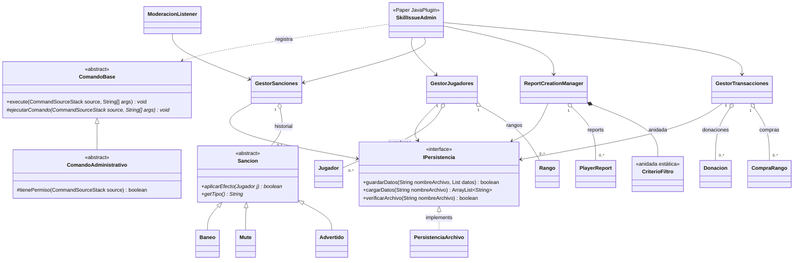
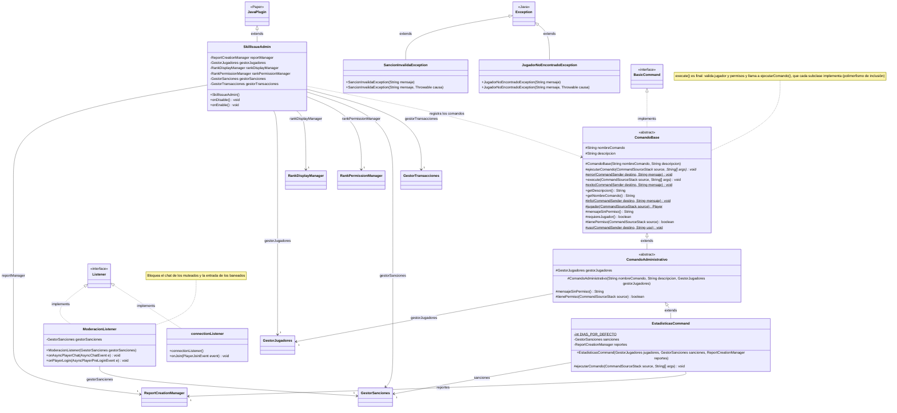
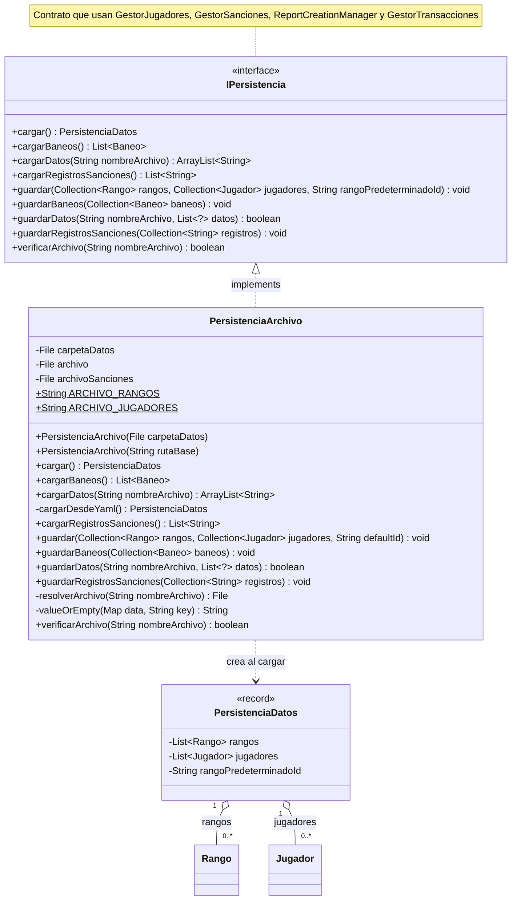
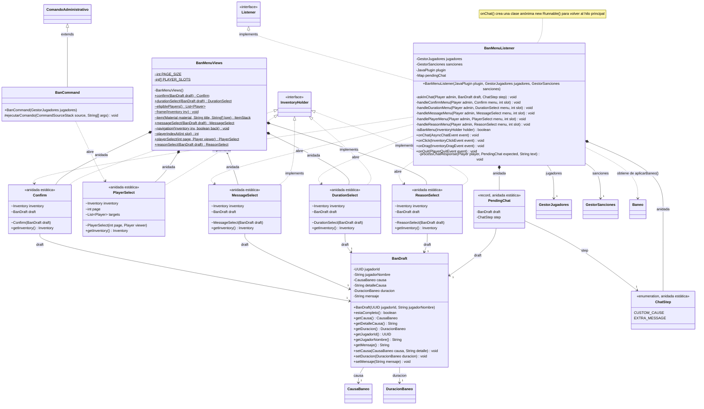
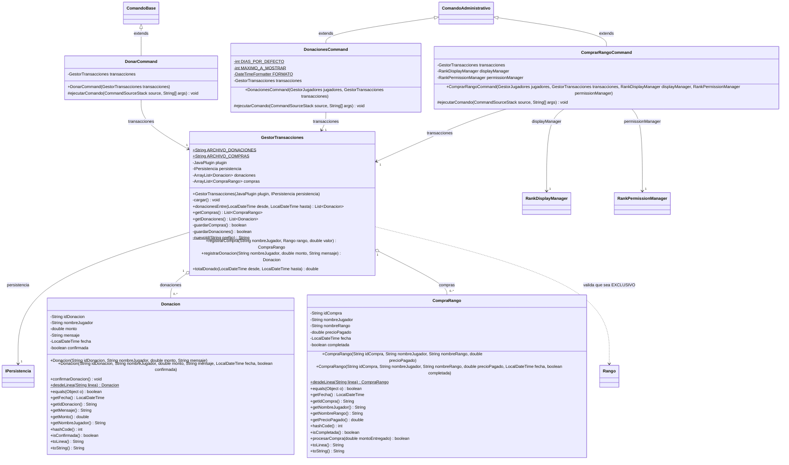

# Diagrama de clases UML — Skill Issue Admin

Diagrama de la versión final (Entrega 3). Coincide **1:1 con el código** de `src/main/java/ErrorCapa8/skillIssueAdmin/`: los atributos, métodos, parámetros y relaciones de los diagramas detallados se tomaron directamente de las clases compiladas.

## Cómo leer el diagrama

| Símbolo | Significado |
| :---: | :--- |
| `+` `-` `#` `~` | Visibilidad: público, privado, protegido y de paquete |
| `$` al final | Atributo o método **estático** |
| `*` al final | Método **abstracto** |
| `<<abstract>>` `<<interface>>` `<<enumeration>>` `<<record>>` | Tipo de clase |
| `<<anidada estática>>` | Clase declarada dentro de otra (se une a su clase externa con `*--` "anidada") |
| `A <\|-- B` | Herencia: B **extiende** a A |
| `A <\|.. B` | Implementación: B **implementa** la interfaz A |
| `A --> "1" B` | Asociación: A tiene un atributo de tipo B |
| `A "1" o-- "0..*" B` | Agregación: A tiene una colección de B |
| `A *-- B` | B es una clase anidada dentro de A |
| `A ..> B` | Dependencia: A usa, crea, abre o lanza B |

`BasicCommand`, `Listener`, `InventoryHolder` y `JavaPlugin` son de la API de Paper; `Exception` es de Java.

## Diagrama general

Vista resumida con las clases principales de cada capa y cómo se relacionan.

## Diagramas detallados por módulo

1. [Núcleo, comandos base, excepciones y listeners](#1-núcleo-comandos-base-excepciones-y-listeners)
2. [Persistencia (archivos planos)](#2-persistencia-archivos-planos)
3. [Jugadores y rangos](#3-jugadores-y-rangos)
4. [Interfaz gráfica de rangos](#4-interfaz-gráfica-de-rangos-menús-de-inventario)
5. [Sanciones](#5-sanciones)
6. [Interfaz gráfica de baneos](#6-interfaz-gráfica-de-baneos-asistente-de-ban)
7. [Reportes](#7-reportes)
8. [Donaciones y compras de rangos](#8-donaciones-y-compras-de-rangos)

Cuando una relación apunta a una clase de otro módulo, esa clase aparece como un recuadro vacío; su detalle está en su propia sección.

### 1. Núcleo, comandos base, excepciones y listeners

### 2. Persistencia (archivos planos)

### 3. Jugadores y rangos

```mermaid
classDiagram
    direction TB
    class Jugador {
        +int NIVEL_MIN_MIEMBRO$
        +int MONEDAS_MIN_MIEMBRO$
        -UUID uuid
        -String nombre
        -String rangoId
        -int nivel
        -long monedas
        -long horasJugadas
        -Instant fechaIngreso
        +Jugador(UUID uuid, String nombre, String rangoId)
        +Jugador(UUID uuid, String nombre, String rangoId, int nivel, long monedas, long horasJugadas, Instant fechaIngreso)
        +actualizar(String nombre, String rangoId) void
        +actualizarProgreso(int nivel, long monedas, long horasJugadas) void
        +asignarRango(String rangoId) void
        +desdeLinea(String linea)$ Jugador
        +getFechaIngreso() Instant
        +getHorasJugadas() long
        +getMonedas() long
        +getNivel() int
        +getNombre() String
        +getRangoId() String
        +getUuid() UUID
        +registrarHoras(int horas) void
        +requisitosFaltantes() String
        +subirRangoGratuito(Rango rangoMiembro) boolean
        +toString() String
    }
    class Rango {
        -String id
        -String nombre
        -TipoRango tipo
        -boolean base
        -TextColor color
        -EnumSet~TextDecoration~ formatos
        +Rango(String nombre, TipoRango tipo, boolean base)
        +Rango(String id, String nombre, TipoRango tipo, boolean base)
        +Rango(String id, String nombre, TipoRango tipo, boolean base, TextColor color)
        +Rango(String id, String nombre, TipoRango tipo, boolean base, TextColor color, Set~TextDecoration~ formatos)
        +colorPredeterminado(TipoRango tipo)$ NamedTextColor
        +esBase() boolean
        +esPago() boolean
        +esValidoComoPredeterminado() boolean
        +getColor() TextColor
        +getColorNombre() String
        +getFormatos() Set~TextDecoration~
        +getId() String
        +getNombre() String
        +getPermisos() Set~String~
        +getTipo() TipoRango
        +normalizarId(String nombre)$ String
        +parseColor(String value)$ TextColor
        +setBase(boolean base) void
        +setColor(TextColor color) void
        +setFormatos(Set~TextDecoration~ formatos) void
        +tieneFormato(TextDecoration formato) boolean
        +tienePermiso(String permiso) boolean
    }
    class TipoRango {
        <<enumeration>>
        ADMIN
        OP
        MOD
        PLAYER
        EXCLUSIVO
        -Set~String~ permisos
        +permisos() Set~String~
        +puedeGestionarRangos() boolean
        +tienePermisosElevados() boolean
    }
    class GestorJugadores {
        +String ARCHIVO_JUGADORES$
        -Pattern NOMBRE_VALIDO$
        -JavaPlugin plugin
        -IPersistencia persistencia
        -Map rangos
        -Map jugadoresPorUuid
        -ArrayList~Jugador~ jugadores
        -String rangoPredeterminadoId
        +String RANGO_MIEMBRO$
        -Pattern NICK_VALIDO$
        +GestorJugadores(IPersistencia persistencia)
        +GestorJugadores(JavaPlugin plugin, IPersistencia persistencia)
        +actualizarEstadisticasJuego(Player player) void
        +actualizarHoras(String id, int horas) void
        +actualizarProgreso(UUID uuid, int nivel, long monedas, long horasJugadas) void
        -asegurarBase(String id, String nombre, TipoRango tipo) boolean
        -asegurarRangosBase() boolean
        +asignarRango(UUID jugadorId, String rangoId) void
        +buscarJugador(UUID uuid) Jugador
        +buscarJugador(String id) Jugador
        +buscarJugador(String nombre, boolean exacto) Jugador
        +buscarRango(String id) Rango
        +buscarRangoPorNombre(String nombre) Rango
        +cambiarEstilo(String rangoId, TextColor color, Set~TextDecoration~ formatos) void
        -cargar() void
        +crearRango(String nombre, TipoRango tipo) Rango
        +crearRango(String nombre, TipoRango tipo, TextColor color, Set~TextDecoration~ formatos) Rango
        +eliminarJugador(String id) boolean
        +eliminarRango(String rangoId) void
        +esAdministrador(UUID uuid) boolean
        +establecerMonedas(UUID uuid, long monedas) void
        +establecerRangoPredeterminado(String rangoId) void
        -guardar() void
        +jugadoresConRango(String rangoId) List~Jugador~
        -migrarBaseModeradorAOp() boolean
        +obtenerJugadores() List~Jugador~
        +obtenerRangoJugador(UUID uuid) Rango
        +obtenerRangoPredeterminado() Rango
        +obtenerRangos() Collection~Rango~
        +obtenerRangos(TipoRango tipo) List~Rango~
        +registrarJugador(Jugador j) void
        +registrarJugadorManual(String nick, int nivel, long monedas) Jugador
        +registrarOActualizarJugador(Player player) void
        -sincronizarListaJugadores() void
        +subirRangoGratuito(UUID uuid) void
        +validarConexionGlobal(String ip)$ boolean
    }
    class RankPermissionManager {
        -JavaPlugin plugin
        -GestorJugadores gestor
        -Map attachments
        -Set~String~ managedPermissions
        +RankPermissionManager(JavaPlugin plugin, GestorJugadores gestor)
        +apply(Player player) void
        +clear(Player player) void
        +clearAll() void
        +refreshAll() void
    }
    class RankDisplayManager {
        -String TEAM_PREFIX$
        -JavaPlugin plugin
        -GestorJugadores gestor
        -Map bindings
        -Set~Scoreboard~ touchedScoreboards
        +RankDisplayManager(JavaPlugin plugin, GestorJugadores gestor)
        -applyToBoard(Player player, Rango rango, Scoreboard scoreboard, Map playerBindings) void
        +onJoin(PlayerJoinEvent event) void
        +onQuit(PlayerQuitEvent event) void
        +refreshAll() void
        +refreshPlayer(Player player) void
        -removeOwnedEntry(Binding binding) void
        +removePlayer(Player player) void
        +shutdown() void
        -teamName(String rankId) String
    }
    class Binding {
        <<record, anidada estática>>
        -Scoreboard scoreboard
        -String entry
        -String teamName
    }
    class RegistroJugadorListener {
        -GestorJugadores gestor
        -RankDisplayManager displayManager
        -RankPermissionManager permissionManager
        +RegistroJugadorListener(GestorJugadores gestor, RankDisplayManager displayManager, RankPermissionManager permissionManager)
        +onJoin(PlayerJoinEvent event) void
        +onQuit(PlayerQuitEvent event) void
    }
    class RankCommand {
        +RankCommand(GestorJugadores gestor)
        #ejecutarComando(CommandSourceStack source, String[] args) void
    }
    class ProfileCommand {
        -DateTimeFormatter DATE_FORMAT$
        -GestorJugadores jugadores
        -GestorSanciones sanciones
        +ProfileCommand(GestorJugadores jugadores, GestorSanciones sanciones)
        #ejecutarComando(CommandSourceStack source, String[] args) void
        #requiereJugador() boolean
    }
    class JugadorCommand {
        +JugadorCommand(GestorJugadores gestor)
        #ejecutarComando(CommandSourceStack source, String[] args) void
    }
    class SubirRangoCommand {
        -GestorJugadores gestor
        -RankDisplayManager displayManager
        -RankPermissionManager permissionManager
        +SubirRangoCommand(GestorJugadores gestor, RankDisplayManager displayManager, RankPermissionManager permissionManager)
        #ejecutarComando(CommandSourceStack source, String[] args) void
    }
    class Listener {
        <<interface>>
    }
    Rango --> "1" TipoRango : tipo
    GestorJugadores --> "1" IPersistencia : persistencia
    GestorJugadores "1" o-- "0..*" Rango : rangos
    GestorJugadores "1" o-- "0..*" Jugador : jugadoresPorUuid
    GestorJugadores "1" o-- "0..*" Jugador : jugadores
    GestorJugadores ..> JugadorNoEncontradoException : lanza
    RankPermissionManager --> "1" GestorJugadores : gestor
    Listener <|.. RankDisplayManager : implements
    RankDisplayManager --> "1" GestorJugadores : gestor
    RankDisplayManager *-- Binding : anidada
    Listener <|.. RegistroJugadorListener : implements
    RegistroJugadorListener --> "1" GestorJugadores : gestor
    RegistroJugadorListener --> "1" RankDisplayManager : displayManager
    RegistroJugadorListener --> "1" RankPermissionManager : permissionManager
    ComandoAdministrativo <|-- RankCommand : extends
    ComandoBase <|-- ProfileCommand : extends
    ProfileCommand --> "1" GestorJugadores : jugadores
    ProfileCommand --> "1" GestorSanciones : sanciones
    ComandoAdministrativo <|-- JugadorCommand : extends
    ComandoBase <|-- SubirRangoCommand : extends
    SubirRangoCommand --> "1" GestorJugadores : gestor
    SubirRangoCommand --> "1" RankDisplayManager : displayManager
    SubirRangoCommand --> "1" RankPermissionManager : permissionManager
    GestorJugadores ..> PersistenciaDatos : recibe al cargar
    RankCommand ..> RankMainMenu : abre
    ProfileCommand --> "1" GestorSanciones : sanciones
```

### 4. Interfaz gráfica de rangos (menús de inventario)

```mermaid
classDiagram
    direction TB
    class RankMenuListener {
        -long DELETE_DELAY_MILLIS$
        -SkillIssueAdmin plugin
        -GestorJugadores gestor
        -RankDisplayManager displayManager
        -RankPermissionManager permissionManager
        -Map pendingCreation
        -Map pendingHexInput
        -Map deletionCountdowns
        +RankMenuListener(SkillIssueAdmin plugin, GestorJugadores gestor, RankDisplayManager displayManager, RankPermissionManager permissionManager)
        -abrirConfirmacion(Player player, Rango rango) void
        -cancelarCuenta(UUID playerId) void
        +onChat(AsyncChatEvent event) void
        +onInventoryClick(InventoryClickEvent event) void
        +onInventoryClose(InventoryCloseEvent event) void
        +onInventoryDrag(InventoryDragEvent event) void
        +onQuit(PlayerQuitEvent event) void
    }
    class PendingCreation {
        <<record, anidada estática>>
        -TipoRango tipo
        -TextColor color
        -Set~TextDecoration~ formatos
    }
    class RankMainMenu {
        -Inventory inventory
        +RankMainMenu(GestorJugadores gestor)
        +getInventory() Inventory
    }
    class RankTypeMenu {
        -int[] SLOTS$
        -TipoRango[] TYPES$
        -Inventory inventory
        +RankTypeMenu()
        +getInventory() Inventory
        ~tipoAt(int slot)$ TipoRango
    }
    class RankColorMenu {
        -NamedTextColor[] COLORS$
        -Material[] COLOR_ICONS$
        -TextDecoration[] FORMATS$
        -int[] FORMAT_SLOTS$
        -Material[] FORMAT_ICONS$
        -String[] FORMAT_LABELS$
        -Inventory inventory
        -boolean creation
        -String rangoId
        -String previewName
        -TipoRango tipo
        -TextColor color
        -EnumSet~TextDecoration~ formatos
        +RankColorMenu(Rango rango)
        +RankColorMenu(TipoRango tipo)
        -RankColorMenu(boolean creation, String rangoId, String previewName, TipoRango tipo, TextColor color, Set~TextDecoration~ formatos)
        +color() TextColor
        ~colorAt(int slot)$ TextColor
        -colorPersistido() String
        +creation() boolean
        ~formatAt(int slot)$ TextDecoration
        +formatos() Set~TextDecoration~
        +getInventory() Inventory
        -previewComponent() Component
        +previewName() String
        +rangoId() String
        -refresh() void
        +setColor(TextColor color) void
        +tipo() TipoRango
        +toggle(TextDecoration decoration) void
    }
    class RankRgbColorMenu {
        -String[] HEX$
        -String[] LABELS$
        -Material[] ICONS$
        -Inventory inventory
        -RankColorMenu parent
        +RankRgbColorMenu(RankColorMenu parent)
        ~colorAt(int slot)$ TextColor
        -colorAtIndex(int index)$ TextColor
        +getInventory() Inventory
        +parent() RankColorMenu
    }
    class RankListMenu {
        -Inventory inventory
        -Mode mode
        -int page
        -List~Rango~ rangos
        +RankListMenu(GestorJugadores gestor, Mode mode, int page)
        +getInventory() Inventory
        +mode() Mode
        +page() int
        +rangoAt(int rawSlot) Rango
    }
    class Mode {
        <<enumeration, anidada estática>>
        DEFAULT
        DELETE
        COLOR
    }
    class RankPlayerSelectMenu {
        -Inventory inventory
        -List~Jugador~ jugadores
        -int page
        +RankPlayerSelectMenu(GestorJugadores gestor, int page)
        +getInventory() Inventory
        +jugadorAt(int slot) Jugador
        +page() int
    }
    class RankAssignmentMenu {
        -Inventory inventory
        -Jugador jugador
        -List~Rango~ rangos
        -int page
        +RankAssignmentMenu(GestorJugadores gestor, Jugador jugador, int page)
        +getInventory() Inventory
        +jugador() Jugador
        +page() int
        +rangoAt(int slot) Rango
    }
    class RankAssignmentConfirmMenu {
        -Inventory inventory
        -UUID jugadorId
        -String jugadorNombre
        -String rangoId
        -String rangoNombre
        +RankAssignmentConfirmMenu(Jugador jugador, Rango rango, Rango actual)
        +getInventory() Inventory
        +jugadorId() UUID
        +jugadorNombre() String
        +rangoId() String
        +rangoNombre() String
    }
    class RankDeleteConfirmMenu {
        -Inventory inventory
        -String rangoId
        -String rangoNombre
        -long habilitadoEn
        +RankDeleteConfirmMenu(String rangoId, String rangoNombre, long habilitadoEn, int remainingSeconds)
        +getInventory() Inventory
        +habilitadoEn() long
        +rangoId() String
        +rangoNombre() String
        +update(int remainingSeconds) void
    }
    class RankItems {
        -RankItems()
        ~contentSlots()$ int[]
        ~frame(Inventory inventory)$ void
        ~item(Material material, Component name, String[] lore)$ ItemStack
        ~item(Material material, String name, String[] lore)$ ItemStack
    }
    class InventoryHolder {
        <<interface>>
    }
    class Listener {
        <<interface>>
    }
    Listener <|.. RankMenuListener : implements
    RankMenuListener --> "1" SkillIssueAdmin : plugin
    RankMenuListener --> "1" GestorJugadores : gestor
    RankMenuListener --> "1" RankDisplayManager : displayManager
    RankMenuListener --> "1" RankPermissionManager : permissionManager
    RankMenuListener "1" o-- "0..*" RankColorMenu : pendingHexInput
    RankMenuListener *-- PendingCreation : anidada
    PendingCreation --> "1" TipoRango : tipo
    InventoryHolder <|.. RankMainMenu : implements
    InventoryHolder <|.. RankTypeMenu : implements
    RankTypeMenu --> "1" TipoRango : TYPES
    InventoryHolder <|.. RankColorMenu : implements
    RankColorMenu --> "1" TipoRango : tipo
    InventoryHolder <|.. RankRgbColorMenu : implements
    RankRgbColorMenu --> "1" RankColorMenu : parent
    InventoryHolder <|.. RankListMenu : implements
    RankListMenu "1" o-- "0..*" Rango : rangos
    RankListMenu *-- Mode : anidada
    InventoryHolder <|.. RankPlayerSelectMenu : implements
    RankPlayerSelectMenu "1" o-- "0..*" Jugador : jugadores
    InventoryHolder <|.. RankAssignmentMenu : implements
    RankAssignmentMenu --> "1" Jugador : jugador
    RankAssignmentMenu "1" o-- "0..*" Rango : rangos
    InventoryHolder <|.. RankAssignmentConfirmMenu : implements
    InventoryHolder <|.. RankDeleteConfirmMenu : implements
    RankMenuListener ..> RankMainMenu : abre
    RankMenuListener ..> RankTypeMenu : abre
    RankMenuListener ..> RankColorMenu : abre
    RankMenuListener ..> RankRgbColorMenu : abre
    RankMenuListener ..> RankListMenu : abre
    RankMenuListener ..> RankPlayerSelectMenu : abre
    RankMenuListener ..> RankAssignmentMenu : abre
    RankMenuListener ..> RankAssignmentConfirmMenu : abre
    RankMenuListener ..> RankDeleteConfirmMenu : abre
```

### 5. Sanciones

```mermaid
classDiagram
    direction TB
    class Sancion {
        <<abstract>>
        +String SEPARADOR$
        +DateTimeFormatter FORMATO_FECHA$
        -int contadorSanciones$
        -UUID id
        -UUID jugadorId
        -String jugadorNombre
        -UUID responsableId
        -String responsableNombre
        -Instant creadaEn
        -int numero
        -String motivo
        -boolean activa
        -String motivoPerdon
        -Instant revocadaEn
        #Sancion(UUID id, UUID jugadorId, String jugadorNombre, UUID responsableId, String responsableNombre, Instant creadaEn)
        #Sancion(UUID id, int numero, UUID jugadorId, String jugadorNombre, UUID responsableId, String responsableNombre, Instant creadaEn, String motivo, boolean activa, String motivoPerdon)
        #actualizarContador(int numeroExistente)$ void
        +aplicarEfecto(Jugador j)* boolean
        #buscarJugadorConectado(Jugador j) Player
        #datosExtra()* String
        +desdeLinea(String linea)$ Sancion
        +estaVigente(Instant ahora) boolean
        ~fijarContador(int valor)$ void
        +getAdminResponsable() String
        +getCreadaEn() Instant
        +getFecha() String
        +getId() UUID
        +getJugadorId() UUID
        +getJugadorNombre() String
        +getMotivo() String
        +getMotivoPerdon() String
        +getNivelEnEscala() NivelSeveridad
        +getNumero() int
        +getResponsableId() UUID
        +getResponsableNombre() String
        +getResumen() String
        +getRevocadaEn() Instant
        +getSiguienteId()$ int
        +getTipo()* String
        +getTipoInfraccion() CausaBaneo
        #guionComoVacio(String texto)$ String
        +haExpirado(Instant ahora) boolean
        +isActiva() boolean
        #limpiar(String texto)$ String
        ~restaurarActiva() void
        +revocar(String motivoPerdon) void
        +toLinea() String
        +toString() String
        #vacioComoGuion(String texto)$ String
    }
    class Baneo {
        -CausaBaneo causa
        -String detalleCausa
        -String mensaje
        -Instant expiraEn
        -boolean permanente
        +Baneo(UUID id, UUID jugadorId, String jugadorNombre, CausaBaneo causa, String detalleCausa, String mensaje, UUID responsableId, String responsableNombre, Instant creadaEn, Instant expiraEn, boolean permanente)
        ~Baneo(int numero, boolean activa, String motivoPerdon, UUID id, UUID jugadorId, String jugadorNombre, CausaBaneo causa, String detalleCausa, String mensaje, UUID responsableId, String responsableNombre, Instant creadaEn, Instant expiraEn, boolean permanente)
        +aplicarEfecto(Jugador j) boolean
        +causaCompleta() String
        #datosExtra() String
        +duracionTexto() String
        +esPermanente() boolean
        +estaActivo(Instant ahora) boolean
        +getCausa() CausaBaneo
        +getDetalleCausa() String
        +getExpiraEn() Instant
        +getMensaje() String
        +getMotivo() String
        +getNivelEnEscala() NivelSeveridad
        +getTipo() String
        +getTipoInfraccion() CausaBaneo
        +haExpirado(Instant ahora) boolean
        +mensajeIngreso() String
        +mensajeKick() Component
    }
    class Mute {
        +String CANAL_GLOBAL$
        -int duracionMinutos
        -String canalSilenciado
        -CausaBaneo tipoInfraccion
        +Mute(UUID jugadorId, String jugadorNombre, UUID responsableId, String responsableNombre, CausaBaneo tipoInfraccion, String motivo, int duracionMinutos, String canalSilenciado)
        ~Mute(UUID id, int numero, UUID jugadorId, String jugadorNombre, UUID responsableId, String responsableNombre, Instant creadaEn, String motivo, boolean activa, String motivoPerdon, int duracionMinutos, String canalSilenciado, CausaBaneo tipoInfraccion)
        +aplicarEfecto(Jugador j) boolean
        #datosExtra() String
        +getCanalSilenciado() String
        +getDuracionMinutos() int
        +getExpiraEn() Instant
        +getNivelEnEscala() NivelSeveridad
        +getTipo() String
        +getTipoInfraccion() CausaBaneo
        +haExpirado(Instant ahora) boolean
        +mensajeSilenciado() Component
    }
    class Advertido {
        -int nivelSeveridad
        -boolean requiereConfirmacion
        +Advertido(UUID jugadorId, String jugadorNombre, UUID responsableId, String responsableNombre, String motivo, int nivelSeveridad, boolean requiereConfirmacion)
        ~Advertido(UUID id, int numero, UUID jugadorId, String jugadorNombre, UUID responsableId, String responsableNombre, Instant creadaEn, String motivo, boolean activa, String motivoPerdon, int nivelSeveridad, boolean requiereConfirmacion)
        +aplicarEfecto(Jugador j) boolean
        #datosExtra() String
        +getNivelSeveridad() int
        +getNombreSeveridad() String
        +getTipo() String
        +isRequiereConfirmacion() boolean
    }
    class NivelSeveridad {
        <<enumeration>>
        MUTE
        BANEO_TEMPORAL
        BANEO_PERMANENTE
        -String etiqueta
        +etiqueta() String
        +subir() NivelSeveridad
    }
    class CausaBaneo {
        <<enumeration>>
        INSULTOS
        TRAMPAS
        SPAM
        TOXICIDAD
        EXPLOITS
        OTRA
        -String etiqueta
        -String descripcion
        -Material icono
        +descripcion() String
        +etiqueta() String
        +icono() Material
    }
    class DuracionBaneo {
        <<enumeration>>
        UN_DIA
        TRES_DIAS
        SIETE_DIAS
        CATORCE_DIAS
        TREINTA_DIAS
        PERMANENTE
        -String etiqueta
        -int dias
        -Material icono
        +calcularExpiracion(Instant creadoEn) Instant
        +etiqueta() String
        +icono() Material
    }
    class GestorSanciones {
        +String ARCHIVO$
        -JavaPlugin plugin
        -IPersistencia persistencia
        -GestorJugadores gestorJugadores
        -ArrayList~Sancion~ historial
        -ArrayList~Sancion~ sancionesActivas
        +int PERIODO_PRUEBA_DIAS$
        +int VENTANA_REINCIDENCIA_DIAS$
        +int UMBRAL_REINCIDENCIA$
        +GestorSanciones(JavaPlugin plugin, IPersistencia persistencia, GestorJugadores gestorJugadores)
        -agregarDesdeLinea(String linea, Set~UUID~ idsCargados) boolean
        +aplicarBaneo(BanDraft draft, Player administrador) Baneo
        +aplicarSancion(Jugador j, Sancion s) void
        +buscarPorNumero(int numero) Sancion
        +calcularNivelSugerido(Jugador j, CausaBaneo tipoInfraccion, NivelSeveridad pedido) SugerenciaSeveridad
        +calcularReincidencia(Jugador j) int
        -cargar() void
        +estaEnPeriodoDePrueba(UUID jugadorId) boolean
        +estaMuteado(UUID jugadorId) boolean
        +estadoJugador(UUID jugadorId) String
        +finPeriodoDePrueba(UUID jugadorId) Instant
        +getHistorial() ArrayList~Sancion~
        +getNivelReincidencia(Jugador j) String
        +getSancionesActivas() ArrayList~Sancion~
        +guardar() boolean
        +levantarSancion(int idSancion) boolean
        +levantarSancion(int idSancion, String motivoPerdon) boolean
        +limpiarExpiradas() void
        +obtenerBaneoActivo(UUID jugadorId, Instant ahora) Optional~Baneo~
        +obtenerBaneos() List~Baneo~
        +obtenerMuteActivo(UUID jugadorId) Mute
        +obtenerSancionesPorJugador(String id) ArrayList~Sancion~
        +obtenerSancionesPorJugador(UUID id) ArrayList~Sancion~
        -registrarYGuardar(Sancion s) void
    }
    class SugerenciaSeveridad {
        <<record, anidada estática>>
        -NivelSeveridad nivel
        -List~String~ razones
        +subio() boolean
    }
    class MuteCommand {
        +int DIAS_BANEO_POR_REINCIDENCIA$
        -GestorSanciones sanciones
        +MuteCommand(GestorJugadores jugadores, GestorSanciones sanciones)
        #ejecutarComando(CommandSourceStack source, String[] args) void
        +suggest(CommandSourceStack source, String[] args) Collection~String~
        ~tipoInfraccion(String texto)$ CausaBaneo
    }
    class WarnCommand {
        -GestorSanciones sanciones
        +WarnCommand(GestorJugadores jugadores, GestorSanciones sanciones)
        #ejecutarComando(CommandSourceStack source, String[] args) void
    }
    class SancionesCommand {
        -int MAXIMO_A_MOSTRAR$
        -GestorSanciones sanciones
        +SancionesCommand(GestorJugadores jugadores, GestorSanciones sanciones)
        #ejecutarComando(CommandSourceStack source, String[] args) void
    }
    class PerdonarCommand {
        -GestorSanciones sanciones
        +PerdonarCommand(GestorJugadores jugadores, GestorSanciones sanciones)
        #ejecutarComando(CommandSourceStack source, String[] args) void
    }
    Sancion ..> SancionInvalidaException : lanza
    Sancion <|-- Baneo : extends
    Baneo --> "1" CausaBaneo : causa
    Sancion <|-- Mute : extends
    Mute --> "1" CausaBaneo : tipoInfraccion
    Mute ..> SancionInvalidaException : lanza
    Sancion <|-- Advertido : extends
    Advertido ..> SancionInvalidaException : lanza
    GestorSanciones --> "1" IPersistencia : persistencia
    GestorSanciones --> "1" GestorJugadores : gestorJugadores
    GestorSanciones "1" o-- "0..*" Sancion : historial
    GestorSanciones "1" o-- "0..*" Sancion : sancionesActivas
    GestorSanciones ..> SancionInvalidaException : lanza
    GestorSanciones *-- SugerenciaSeveridad : anidada
    SugerenciaSeveridad --> "1" NivelSeveridad : nivel
    ComandoAdministrativo <|-- MuteCommand : extends
    MuteCommand --> "1" GestorSanciones : sanciones
    ComandoAdministrativo <|-- WarnCommand : extends
    WarnCommand --> "1" GestorSanciones : sanciones
    ComandoAdministrativo <|-- SancionesCommand : extends
    SancionesCommand --> "1" GestorSanciones : sanciones
    ComandoAdministrativo <|-- PerdonarCommand : extends
    PerdonarCommand --> "1" GestorSanciones : sanciones
    MuteCommand ..> Mute : crea
    MuteCommand ..> Baneo : crea si hay reincidencia
    WarnCommand ..> Advertido : crea
    note for Sancion "aplicarEfecto() es abstracto: Baneo expulsa, Mute avisa el silencio y Advertido muestra título y sonido"
```

### 6. Interfaz gráfica de baneos (asistente de /ban)

### 7. Reportes

```mermaid
classDiagram
    direction TB
    class PlayerReport {
        +String SEPARADOR$
        -int contadorReportes$
        -int numero
        -UUID id
        -UUID reporterId
        -String reporterName
        -UUID targetId
        -String targetName
        -ReportType type
        -String motivo
        -Instant createdAt
        -ReportPriority priority
        -EstadoReporte estado
        -String resolvedBy
        -Instant resolvedAt
        +PlayerReport(UUID reporterId, String reporterName, UUID targetId, String targetName, ReportType type, String motivo)
        +PlayerReport(int numero, UUID id, UUID reporterId, String reporterName, UUID targetId, String targetName, ReportType type, String motivo, Instant createdAt, ReportPriority priority, EstadoReporte estado, String resolvedBy, Instant resolvedAt)
        ~actualizarContador(int numeroExistente)$ void
        +cambiarEstado(EstadoReporte nuevo, String staff) void
        +createdAt() Instant
        +desdeLinea(String linea)$ PlayerReport
        +estado() EstadoReporte
        +getSiguienteId()$ int
        +id() UUID
        -limpiar(String texto)$ String
        +motivo() String
        +numero() int
        +priority() ReportPriority
        +reporterId() UUID
        +reporterName() String
        +resolved() boolean
        +resolvedAt() Instant
        +resolvedBy() String
        +setPriority(ReportPriority priority) void
        +targetId() UUID
        +targetName() String
        +toLinea() String
        +toString() String
        +type() ReportType
    }
    class EstadoReporte {
        <<enumeration>>
        ABIERTO
        EN_REVISION
        RESUELTO
        DESCARTADO
        -String etiqueta
        +desdeTexto(String texto)$ EstadoReporte
        +estaCerrado() boolean
        +etiqueta() String
        +puedePasarA(EstadoReporte nuevo) boolean
        +siguiente() EstadoReporte
    }
    class ReportType {
        <<enumeration>>
        SPAM
        TOXICITY
        HACKS
        SCAM
        HARASSMENT
        OTHER
        -String label
        +label() String
    }
    class ReportPriority {
        <<enumeration>>
        LOW
        MEDIUM
        URGENT
        -String label
        -Material icon
        +icon() Material
        +label() String
        +next(int step) ReportPriority
    }
    class ReportCreationManager {
        +String ARCHIVO$
        -long COOLDOWN_MILLIS$
        -SkillIssueAdmin plugin
        -IPersistencia persistencia
        -File archivoAnterior
        -List~PlayerReport~ reports
        -Map lastReportAt
        +ReportCreationManager(SkillIssueAdmin plugin, IPersistencia persistencia)
        +buscarReporte(int numero) PlayerReport
        -cargar() void
        +crearReporte(Player reporter, Player target, ReportType type, String motivo) PlayerReport
        +filtrarReportes(String estado) List~PlayerReport~
        +filtrarReportes(CriterioFiltro criterio) List~PlayerReport~
        -guardar() void
        -migrarDesdeYaml() int
        +remainingCooldownMillis(UUID reporter) long
        +reports() List~PlayerReport~
        +resolverReporte(PlayerReport report, EstadoReporte estado, String staff) void
        +setPriority(PlayerReport report, ReportPriority priority) void
    }
    class CriterioFiltro {
        <<anidada estática>>
        -EstadoReporte estadoBuscado
        -LocalDate fechaDesde
        -LocalDate fechaHasta
        +CriterioFiltro(EstadoReporte estadoBuscado, LocalDate fechaDesde, LocalDate fechaHasta)
        +coincide(PlayerReport report) boolean
        +getEstadoBuscado() EstadoReporte
        +getFechaDesde() LocalDate
        +getFechaHasta() LocalDate
    }
    class ReportPlayer {
        -ReportCreationManager manager
        +ReportPlayer(ReportCreationManager manager)
        #ejecutarComando(CommandSourceStack source, String[] args) void
        -enEspera(Player player) boolean
        +suggest(CommandSourceStack source, String[] args) Collection~String~
    }
    class ReportAdminCommand {
        -int MAXIMO_A_MOSTRAR$
        -DateTimeFormatter FORMATO$
        -ReportCreationManager manager
        +ReportAdminCommand(ReportCreationManager manager)
        #ejecutarComando(CommandSourceStack source, String[] args) void
        #mensajeSinPermiso() String
        -mostrar(Player player, String titulo, List~PlayerReport~ lista) void
        #tienePermiso(CommandSourceStack source) boolean
    }
    class ReportMenuListener {
        -SkillIssueAdmin plugin
        -ReportCreationManager manager
        +ReportMenuListener(SkillIssueAdmin plugin, ReportCreationManager manager)
        ~avisarStaff(String reportado)$ void
        +onClick(InventoryClickEvent event) void
        +onDrag(InventoryDragEvent event) void
    }
    class ReportMenu {
        ~int PAGE_SIZE$
        -int[] SLOTS$
        -Inventory inventory
        -int page
        -UUID viewer
        +ReportMenu(int page, UUID viewer)
        +getInventory() Inventory
        ~onlinePlayers(UUID viewer)$ List~Player~
        +page() int
        ~playerAt(int slot)$ int
        +viewer() UUID
    }
    class ReportTypeMenu {
        -int[] SLOTS$
        -Material[] ICONS$
        -Inventory inventory
        -UUID targetId
        -String targetName
        +ReportTypeMenu(UUID targetId, String targetName)
        +getInventory() Inventory
        +targetId() UUID
        +targetName() String
        ~typeAt(int slot)$ ReportType
    }
    class ReportAdminMenu {
        ~int[] SLOTS$
        -Inventory inventory
        -int page
        -List~PlayerReport~ reports
        +ReportAdminMenu(ReportCreationManager manager, int page)
        +getInventory() Inventory
        +page() int
        +reportAt(int slot) PlayerReport
    }
    class MenuItems {
        -MenuItems()
        ~frame(Inventory inventory)$ void
        ~item(Material material, String name, String[] lore)$ ItemStack
    }
    class InventoryHolder {
        <<interface>>
    }
    class Listener {
        <<interface>>
    }
    PlayerReport --> "1" ReportType : type
    PlayerReport --> "1" ReportPriority : priority
    PlayerReport --> "1" EstadoReporte : estado
    ReportCreationManager --> "1" SkillIssueAdmin : plugin
    ReportCreationManager --> "1" IPersistencia : persistencia
    ReportCreationManager "1" o-- "0..*" PlayerReport : reports
    ReportCreationManager *-- CriterioFiltro : anidada
    CriterioFiltro --> "1" EstadoReporte : estadoBuscado
    ComandoBase <|-- ReportPlayer : extends
    ReportPlayer --> "1" ReportCreationManager : manager
    ComandoBase <|-- ReportAdminCommand : extends
    ReportAdminCommand --> "1" ReportCreationManager : manager
    Listener <|.. ReportMenuListener : implements
    ReportMenuListener --> "1" SkillIssueAdmin : plugin
    ReportMenuListener --> "1" ReportCreationManager : manager
    InventoryHolder <|.. ReportMenu : implements
    InventoryHolder <|.. ReportTypeMenu : implements
    InventoryHolder <|.. ReportAdminMenu : implements
    ReportAdminMenu "1" o-- "0..*" PlayerReport : reports
    ReportPlayer ..> ReportMenu : abre
    ReportPlayer ..> ReportTypeMenu : abre
    ReportAdminCommand ..> ReportAdminMenu : abre
    ReportAdminCommand ..> CriterioFiltro : crea
    ReportMenuListener ..> ReportMenu : abre
    ReportMenuListener ..> ReportTypeMenu : abre
    ReportMenuListener ..> ReportAdminMenu : abre
```

### 8. Donaciones y compras de rangos

